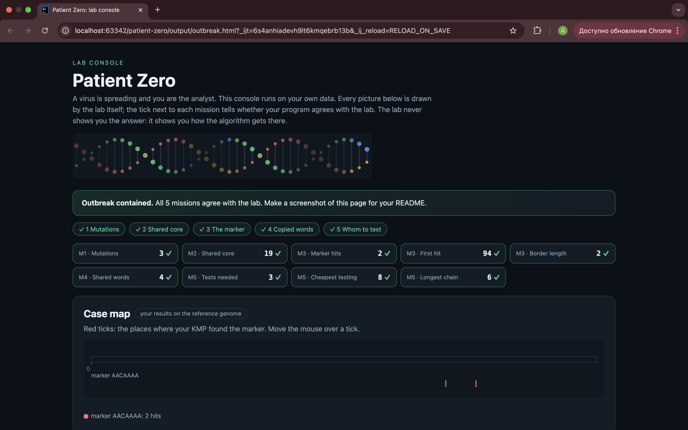

# Assignment 4. Patient Zero

Student ID: 253502  
Name: Turdaly Dias  
Group: SE-2511

## Program output

The 9 lines my program prints on my data (`java -cp out Main`):

```text
Mutations: 80
Shared core: 1115
Marker hits: 4
First hit: 1567
Border length: 4
Shared words: 506
Tests needed: 40
Cheapest testing: 163
Longest chain: 37
```

My outbreak report (a screenshot of `output/outbreak.html`):



## Questions

**Mission 1. What does the cell d[i][j] of your table mean, and how is it computed from other cells?**

`d[i][j]` is the minimum number of changes needed to turn the first i letters of string A into the first j letters of string B. If the letters are equal, I use the diagonal cell. Otherwise, I take the minimum of insert, delete, and replace, and add 1.

**Mission 2. How is the longest common subsequence different from the longest common substring? My Shared core is bigger than the number of letters that are the same at the same place: why?**

A substring must have letters next to each other, but a subsequence can skip letters. My Shared core is bigger because LCS finds matching letters in the same order, even if they are at different positions.

**Mission 3. What does the prefix function tell you, and why does the pointer in the text never go back in KMP? What is the Border length of my marker and what does it mean?**

The prefix function shows the length of the longest matching prefix and suffix. KMP uses this information to continue searching without moving the text pointer back. My Border length is 4, so the first 4 letters of my marker are the same as its last 4 letters.

**Mission 4. Why must you compare the letters after the hashes are equal? What happens to the cost of Rabin-Karp if many windows have the same hash?**

Two different words can have the same hash, so I compare their letters to check the real match. If many windows have the same hash, the algorithm needs more comparisons and becomes slower.

**Mission 5. What are the two states of a person in your DP, and how do you get the answer for a person from its children? Why does a greedy "test the person with most links first" not always give the cheapest answer?**

Each person has two states: tested and not tested. If a person is not tested, all their children must be tested; if the person is tested, I choose the cheaper state for each child. A greedy method may choose a person with many links but a high test cost, so it may not give the cheapest answer.

## AI use

I used ChatGPT to understand the algorithms, learn Dynamic Programming, KMP, Rabin-Karp, and Tree DP, and get help writing and explaining Java code.

## Timing (Mission 7)

Milliseconds, average of 3 runs, from `java -cp out Bench`.

| Test | Size | Time |
|---|---|---|
| Naive search | 20 000 | 33.1 ms |
| Naive search | 40 000 | 73.1 ms |
| Naive search | 80 000 | 150.7 ms |
| KMP | 20 000 | 2.3 ms |
| KMP | 40 000 | 0.9 ms |
| KMP | 80 000 | 0.4 ms |
| Edit distance | 500 | 5.6 ms |
| Edit distance | 1000 | 5.2 ms |
| Edit distance | 2000 | 14.4 ms |
| Edit distance | 4000 | 61.2 ms |

**What do the numbers say about how the time grows?**
Naive search becomes about 2 times slower when the text size doubles. KMP is much faster, but its measured times change because of JVM warm-up and measurement noise. Edit distance grows faster for large inputs, and its time is about 4 times bigger when the size doubles from 2000 to 4000.

## Complexity

Here, n is the text or first strain length, m is the pattern or second strain length, k is the window length, and v is the number of people.

| Algorithm | Time | Space | Assumptions |
|---|---|---|---|
| Edit distance | O(n × m) | O(n × m) | DP table for two strings |
| LCS | O(n × m) | O(n × m) | DP table for two strings |
| Prefix function and KMP | O(n + m) | O(n + m) | Non-empty pattern; includes stored match positions |
| Rabin-Karp (shared words) | O(n + m + k) average | O(m + k) | Hash lookup is fast; hash collisions can make it slower |
| Tree DP | O(v) | O(v) | The graph is a connected tree |


## Before you submit

- The four files in `data` and the screenshot `output/outbreak.png` are in the repository.
- `java tools/Check.java` shows all examples right.
- This README is filled in, the program output and the section AI use included.
- The work is pushed to main (at least one commit per mission) and the repository is public.
- The link is attached in Moodle.
